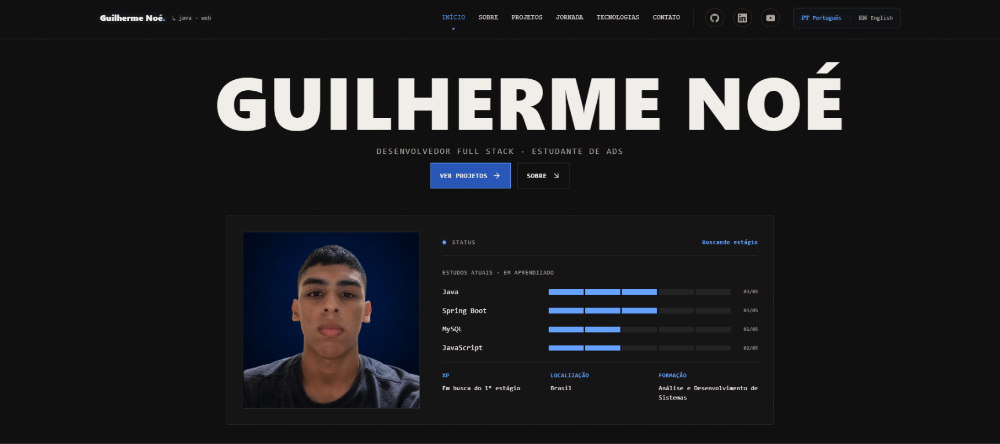
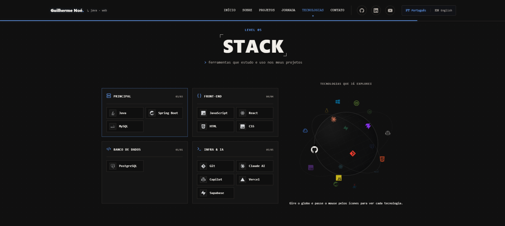

# Portfólio · Guilherme Noé

**[Acessar portfolio](https://portfolio-omega-ten-79.vercel.app/)**

Portfólio pessoal desenvolvido com React e Vite para apresentar meus projetos, habilidades, tecnologias e trajetória como desenvolvedor. Possui interface responsiva com referências visuais de terminal e pixel art.

## Demonstração

As imagens abaixo mostram a página inicial e a seção de tecnologias:

### Página inicial



### Tecnologias



> **Versão online:** o projeto está preparado para publicação na Vercel. Adicione aqui o endereço público após concluir o deploy.

## O que o site apresenta

- Perfil, formação e status de busca por estágio.
- Biografia e terminal interativo com comandos sobre o portfólio.
- Projetos pessoais com tecnologias, repositórios e demonstrações quando disponíveis.
- Jornada de aprendizado e tecnologias organizadas por categoria.
- Globo interativo de tecnologias, com ícones e identificação ao passar o mouse ou tocar.
- Layout responsivo, navegação por seções e suporte a português e inglês.

## Tecnologias utilizadas

- **React** — interface dividida em componentes e seções.
- **JavaScript** — interações e comportamento da aplicação.
- **Vite** — servidor de desenvolvimento e build de produção.
- **CSS** — tema, layout responsivo, animações e efeitos visuais.
- **Lucide React** — ícones de interface.
- **Simple Icons** — logotipos de tecnologias e plataformas.

## O que aprendi desenvolvendo

- Organizar uma aplicação React em componentes reutilizáveis e seções independentes.
- Gerenciar estado e interações com hooks, como idioma, terminal e globo de tecnologias.
- Criar layouts responsivos e ajustar a experiência para diferentes tamanhos de tela.
- Implementar navegação por seções, indicadores de rolagem e animações respeitando a preferência por movimento reduzido.
- Estruturar conteúdo em português e inglês e manter traduções consistentes.
- Integrar bibliotecas de ícones e construir uma experiência visual coerente com CSS.
- Executar o fluxo de desenvolvimento e publicação com Vite, incluindo build de produção e configuração para Vercel.

## Publicação na Vercel

O projeto pode ser publicado conectando este repositório à [Vercel](https://vercel.com/):

1. Importe o repositório do GitHub na Vercel.
2. Selecione **Vite** como framework, se não for detectado automaticamente.
3. Use `npm run build` como comando de build.
4. Use `dist` como diretório de saída.
5. Publique o projeto. A Vercel poderá gerar novos deploys a cada atualização da branch configurada.

## Como executar localmente

### Pré-requisitos

- [Node.js](https://nodejs.org/) 22 ou superior.
- npm, incluído com o Node.js.

### Instalação e execução

```bash
# Clone o repositório
git clone https://github.com/guilhermenoe2020-netizen/portfolio.git

# Entre na pasta do projeto
cd portfolio

# Instale as dependências
npm install

# Inicie o servidor local
npm run dev
```

O Vite exibirá no terminal o endereço local para abrir no navegador.

### Build de produção

```bash
npm run build
npm run preview
```

## Inspiração

O projeto foi inspirado pelo portfólio de [Carlos Eduardo](https://github.com/CarlosEduardo00/portfolio), especialmente pela apresentação visual e pela organização das seções. Este repositório é uma implementação própria, adaptada à minha trajetória, aos meus projetos e às tecnologias que estudo.
